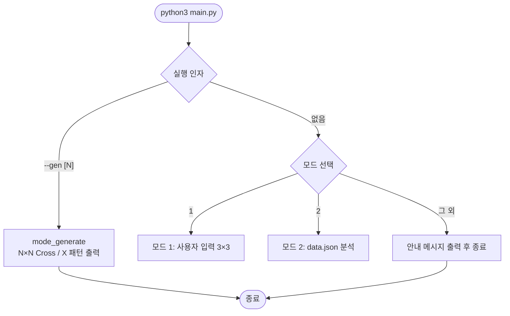
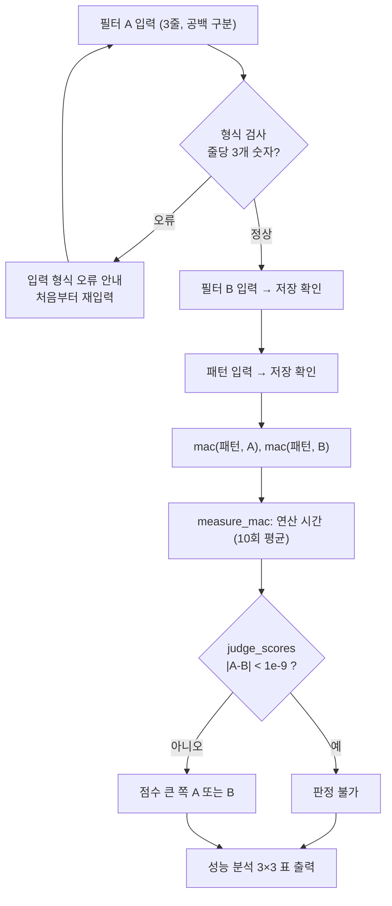
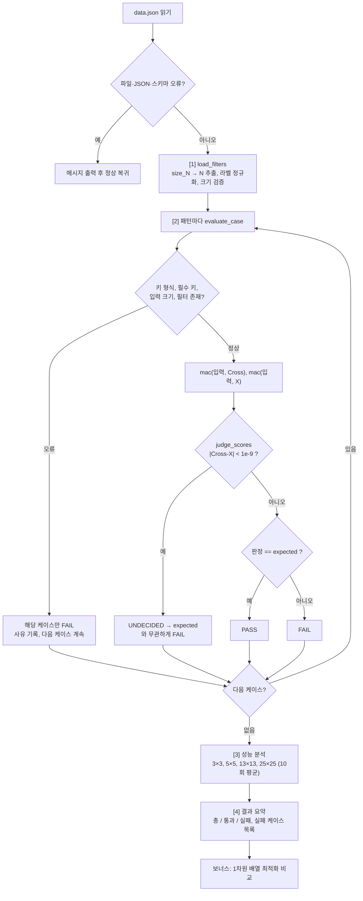

# Mini NPU 시뮬레이터

MAC(Multiply-Accumulate) 연산을 순수 Python(표준 라이브러리만)으로 구현해 3×3 ~ 25×25 Cross(+) / X 패턴을 판별하는 콘솔 애플리케이션입니다. 두 필터와 입력 패턴의 같은 위치 값을 곱해 더한 점수가 높은 쪽을 같은 모양으로 판단합니다.

## 목차

- [한눈에 보기](#한눈에-보기)
- [개발 환경](#개발-환경)
- [파일 구조](#파일-구조)
- [실행 방법](#실행-방법)
- [전체 흐름](#전체-흐름)
- [코드 구조](#코드-구조)
- [결과 리포트](#결과-리포트)
- [성능 및 시간 복잡도](#성능-및-시간-복잡도)
- [보너스: 1차원 배열 최적화 전후 비교](#보너스-1차원-배열-최적화-전후-비교)
- [지원 라벨](#지원-라벨)
- [새 라벨 확장 절차](#새-라벨-확장-절차)
- [대규모 확장 시 최적화 전략](#대규모-확장-시-최적화-전략)
- [관련 문서](#관련-문서)

## 한눈에 보기

| 항목 | 내용 |
| --- | --- |
| 기능 | 모드 1 사용자 입력(3×3), 모드 2 `data.json` 분석, 성능 분석, 결과 리포트 |
| 제공 데이터 결과 | 6건 중 3건 통과, 3건 실패 (실패는 모두 두 점수 차이가 1e-9보다 작은 동점 → `UNDECIDED`) |
| 성능 | 시간 복잡도 O(N²). 25×25에서 MAC 1회 약 0.016ms |
| 보너스 | 패턴 생성기(`--gen`), 1차원 배열 최적화(약 1.3~1.5배) |
| 학습 웹 | https://jihyeongh21-svg.github.io/mini-npu-study/ |

## 개발 환경

| 항목 | 내용 |
| --- | --- |
| 언어 | Python 3.8 이상 |
| 라이브러리 | 표준 라이브러리만 사용 (`json`, `os`, `re`, `sys`, `time`) |
| 금지 사항 | NumPy, pandas 등 외부 라이브러리, 벡터화 연산 |
| 개발·검증 환경 | Ubuntu 24.04 (WSL2), Python 3 |
| 설치 | 필요 없음 (실행만 하면 됩니다) |

## 파일 구조

```
.
├── main.py                 # 프로그램 전체 (제출물)
├── README.md               # 이 문서: 요약, 실행 결과, 분석 (제출물)
├── data.json               # 모드 2 입력 (제공 파일, 같은 폴더에 둡니다)
├── PROJECT_SUMMARY.md      # 평가 항목별 근거와 구두 설명 준비
├── CODE_WALKTHROUGH.md     # 함수별 단계 해부와 실습 문제
└── Mini NPU 시뮬레이터 미션 정리.md   # 미션 요구사항 정리
```

`data.json`은 저장소에 올리지 않으므로 직접 같은 폴더에 두세요. 테스트용 샘플 생성기(`gen_sample.py`)는 제출물에서 제외하며, 실행하면 `data.json`을 덮어쓰니 주의하세요.

## 실행 방법

```bash
python3 main.py            # 1: 사용자 입력(3x3), 2: data.json 분석
python3 main.py --gen 5    # N×N Cross/X 패턴 생성 (N 생략 시 입력 요청)
```

- **모드 1**: 필터 A, 필터 B, 패턴을 3줄씩 공백 구분 숫자로 입력합니다. 줄 수·열 수가 맞지 않거나 숫자가 아니면 안내 후 다시 입력받습니다. 각 행렬의 첫 줄에 `cross` 또는 `x`를 입력하면 3×3 패턴이 자동 생성됩니다.
- **모드 2**: `main.py`와 같은 폴더의 `data.json`을 읽어 [1] 필터 로드, [2] 케이스별 점수·판정·PASS/FAIL, [3] 성능 표, [4] 결과 요약을 순서대로 출력하고, 그 아래에 보너스 1차원 비교 표를 출력합니다.
- **패턴 생성기**: 출력은 공백 구분 숫자라 모드 1에 그대로 붙여넣을 수 있습니다. 성능 분석도 생성기로 만든 N×N 패턴으로 측정합니다. 짝수 N의 십자가는 가운데 2줄을 모두 채워 대칭을 유지합니다.
- **`data.json` 스키마**: `filters.size_N.{cross|+, x}` (N×N 배열), `patterns.size_N_idx.{input, expected}`.

## 전체 흐름

프로그램 시작과 모드 선택



모드 1: 사용자 입력 (3×3)



(필터 B, 패턴 입력에도 같은 형식 검사와 재입력이 적용됩니다. 각 행렬의 첫 줄에 `cross` 또는 `x`를 입력하면 검사 없이 자동 생성됩니다.)

모드 2: data.json 분석



핵심 설계 결정

- **I/O 분리**: `mac`, `judge_scores`는 출력·입력을 하지 않아 시간 측정에 I/O가 섞이지 않습니다.
- **오류 격리**: 검증 오류는 `ValueError`로 올리고 케이스 단위로만 잡아서, 한 케이스의 오류가 프로그램을 중단시키지 않습니다.
- **동점 정책**: 부동소수점 오차 때문에 `==` 대신 `abs(a-b) < 1e-9`로 비교하고, 동점(`UNDECIDED`)은 expected와 비교하면 항상 FAIL입니다.
- **표기 통일**: expected(`+`, `x`)와 필터 키(`cross`, `x`)는 `normalize_label`로 `Cross`/`X`에 맞춥니다.

## 코드 구조

| 함수 | 역할 |
| --- | --- |
| `normalize_label` | `+`/`cross` → Cross, `x` → X, 그 외 오류 |
| `mac` | 이중 for문 위치별 곱셈 누적합 |
| `judge_scores` | epsilon(1e-9) 이내면 UNDECIDED |
| `measure_mac` | I/O 제외, 반복 평균(ms) |
| `validate_matrix` | 정사각 숫자 행렬과 크기 검증 |
| `load_filters` / `evaluate_case` | 스키마·크기 검증, 케이스 단위 오류 처리 |
| `read_matrix` / `mode_user_input` | 모드 1 입력, 재입력, 판정 출력 |
| `mode_json` / `performance_table` | 모드 2 실행, 성능 표, 결과 리포트 |
| `make_cross` / `make_x` / `mode_generate` | 보너스: N×N 패턴 생성기 (`--gen`, 모드 1, 성능 분석에서 재사용) |
| `flatten` / `mac_flat` / `flat_comparison_table` | 보너스: 1차원 배열 최적화와 전후 성능 비교 |

함수별 상세 설명은 [CODE_WALKTHROUGH.md](CODE_WALKTHROUGH.md)를 참고하세요.

## 결과 리포트

제공된 `data.json` 기준입니다.

총 6건 / 통과 3 / 실패 3

| 케이스 | Cross 점수 | X 점수 | 판정 | expected | 결과 |
| --- | --- | --- | --- | --- | --- |
| size_5_1 | 0.9 | 0.9 | UNDECIDED | x | FAIL |
| size_5_2 | 8.9 | 0.1 | Cross | + | PASS |
| size_13_1 | 0.3 | 14.7 | X | x | PASS |
| size_13_2 | 7.5 | 7.5 | UNDECIDED | + | FAIL |
| size_25_1 | 4.9 | 4.9 | UNDECIDED | x | FAIL |
| size_25_2 | 52.9 | 0.1 | Cross | + | PASS |

실제 계산값 (모드 2 출력과 같음)

| 케이스 | Cross 점수 | X 점수 | 차이 |
| --- | --- | --- | --- |
| size_5_1 | 0.9 | 0.8999999999999999 | 1.1e-16 |
| size_13_2 | 7.499999999999997 | 7.5 | 2.7e-15 |
| size_25_1 | 4.9 | 4.899999999999999 | 1.8e-15 |

### 실패 원인 분석
1. 실패 3건(size_5_1, size_13_2, size_25_1)은 모두 두 필터의 점수가 수학적으로는 같지만 부동소수점 오차로 1e-16~1e-15만큼 어긋난 수치 비교 문제입니다. 화면의 `0.9 / 0.9`는 반올림 표시이고, 실제 값은 아래 표와 같습니다.
2. size_5_1은 X 입력에 십자가 필터를 적용하면 중앙 칸 0.9 하나, X 필터를 적용하면 0.1이 9칸이라 수학적으로 둘 다 0.9입니다. 그런데 0.1을 9번 더하면 `0.8999999999999999`가 되어 `0.9`와 1.1e-16 차이가 납니다. `==`로 비교하면 Cross로 잘못 판정되고, epsilon을 쓰면 UNDECIDED가 됩니다. 데이터가 일부러 이 오차를 노린 경우입니다.
3. 필터 값이 0.1, 0.9처럼 부동소수점으로 표현되므로 `==` 비교는 오차로 불안정합니다. `abs(a-b) < 1e-9`로 동점을 판정해 오차에 흔들리지 않게 했습니다.
4. 규칙상 UNDECIDED는 expected와 비교하면 항상 FAIL이므로, 판정이 틀린 것이 아니라 판별 불가라서 실패합니다.
5. 크기 불일치와 스키마 오류는 이 데이터에는 없었지만, 오류 주입 테스트에서 케이스 단위 FAIL로 처리되고 프로그램이 중단되지 않음을 확인했습니다.
6. expected(`+`, `x`)와 필터 키(`cross`, `x`)는 `normalize_label`로 통일해 표기 차이로 인한 거짓 FAIL은 발생하지 않았습니다.

## 성능 및 시간 복잡도

크기별 10회 반복 평균입니다.

| 크기 | 평균 시간(ms) | 연산 횟수(N²) |
| --- | --- | --- |
| 3×3 | 0.0004 | 9 |
| 5×5 | 0.0008 | 25 |
| 13×13 | 0.0039 | 169 |
| 25×25 | 0.0157 | 625 |

### 시간 복잡도 분석
1. MAC은 N×N 이중 루프에서 곱셈과 덧셈을 각 N²번 수행하므로 시간 복잡도는 O(N²)입니다.
2. 3×3 대비 25×25는 연산 횟수가 약 69배 늘며, 측정 시간도 같은 방향으로 크게 증가합니다.
3. 작은 크기에서는 함수 호출·루프 설정의 고정 오버헤드 비중이 커서 시간 비율이 이론값보다 작게 나옵니다.
4. 크기가 커질수록 N²항이 지배적이어서 이론 비율에 가까워집니다.
5. 측정값은 마이크로초 단위라 실행 환경과 부하에 따라 달라지므로 10회 평균을 사용했습니다.
6. 판정 한 번에 필터 2개를 적용하므로 총 연산량은 2N²이며, 점근적 복잡도는 동일합니다.
7. NPU는 이 N²번의 곱셈을 수천 개의 MAC 유닛으로 병렬 처리해 CPU의 직렬 처리 한계를 넘어섭니다.
8. 패턴 수가 K개라면 전체 비용은 O(K·N²)입니다.

## 보너스: 1차원 배열 최적화 전후 비교

2차원 `pattern[i][j]` 대신 `N×N`을 길이 `N²` 리스트로 펼쳐 단일 루프로 계산합니다(`mac_flat`). 연산 횟수는 N²으로 같고, 인덱싱과 안쪽 루프 설정 비용만 줄어듭니다. 결과 일치 여부도 함께 검사합니다. 모드 2 실행 시 결과 요약 아래에 출력됩니다.

| 크기 | 2차원(ms) | 1차원(ms) | 펼침(ms) | 배율 | 결과 일치 |
| --- | --- | --- | --- | --- | --- |
| 3×3 | 0.0003 | 0.0002 | 0.0001 | 1.28× | O |
| 5×5 | 0.0007 | 0.0005 | 0.0001 | 1.50× | O |
| 13×13 | 0.0040 | 0.0028 | 0.0003 | 1.42× | O |
| 25×25 | 0.0131 | 0.0094 | 0.0008 | 1.39× | O |

(100회 반복 평균, 3회 실행에서 배율은 1.3~1.5배 범위였습니다.)

- 개선폭은 약 1.3~1.5배로 크지 않습니다. 시간 복잡도는 여전히 O(N²)이고, 줄어드는 것은 상수 배입니다.
- 펼치는 비용(`펼침`)은 패턴마다 한 번 듭니다. 25×25에서 1차원 시간(0.0094)에 펼침(0.0008)을 더해도 0.0102ms로 2차원(0.0131)보다 빠릅니다. 필터는 한 번만 펼쳐 재사용하므로 필터 쪽 비용은 포함하지 않았습니다.
- 패턴 하나에 필터를 한 번만 적용한다면 이득이 줄어들고, 필터 2개를 적용하거나 같은 필터를 여러 패턴에 재사용할수록 이득이 커집니다.
- 측정값은 환경에 따라 달라집니다.

## 지원 라벨

| 입력 표기 | 내부 표기 | 사용처 |
| --- | --- | --- |
| `+`, `cross` (대소문자·공백 무시) | Cross | expected, 필터 키 |
| `x` (대소문자·공백 무시) | X | expected, 필터 키 |

그 외 표기는 `ValueError`가 되어 해당 케이스만 FAIL 처리됩니다.

## 새 라벨 확장 절차

예: 새 패턴 `Circle`을 추가하는 경우

1. **`normalize_label`**: 허용 표기를 추가합니다. (`if key in ("o", "circle"): return "Circle"`)
2. **`load_filters`**: 필수 필터 검사(`"Cross" not in fs or "X" not in fs`)에 새 라벨을 포함합니다.
3. **`evaluate_case`**: 현재는 Cross/X 2개를 비교하는 구조입니다. 3개 이상이면 `judge_scores`를 "점수 최댓값이 유일한가"를 검사하는 방식으로 일반화합니다. 1위와 2위 차이가 epsilon 이내이면 UNDECIDED로 유지합니다.
4. **`performance_table`**: 필터 선택이 하드코딩되어 있으면 새 라벨도 측정되는지 확인합니다.
5. **테스트**: `data.json`에 (a) 새 라벨 정상 케이스 PASS, (b) 새 라벨과 기존 라벨의 동점 케이스 FAIL, (c) 오타 라벨 FAIL을 추가해 실행합니다.
6. **문서**: 위 "지원 라벨" 표와 "결과 리포트"를 갱신합니다.

## 대규모 확장 시 최적화 전략

패턴 K개, 크기 N 기준입니다.

전체 비용은 O(K·N²)입니다. 효과가 크고 위험이 낮은 순서로 정리했습니다.

| 우선순위 | 전략 | 기대 효과 | 비고 |
| --- | --- | --- | --- |
| 1 | 필터 검증 1회만 수행 (이미 `load_filters`에서 1회) | 반복 검증 제거 | 현재 구현됨 |
| 2 | 2차원 → 1차원 배열로 펼쳐 단일 루프화 | 인덱싱 `[i][j]` 이중 접근 제거, 상수 배 개선 | 구현됨 (`mac_flat`, 약 1.3~1.5배) |
| 3 | 한 패턴을 한 번 순회하며 Cross·X 두 점수를 동시에 계산 | 패턴 메모리 접근 절반 | 두 필터 합산 구조에서 유효 |
| 4 | 0인 필터 값 건너뛰기 (희소 필터, 예: Cross·X 필터는 대부분 0) | 연산량 약 N²→약 2N | 필터가 희소할 때만 유효 |
| 5 | 케이스를 스트리밍 처리 (`json` 전체 로드 대신 케이스별 평가·결과 즉시 출력) | 메모리 O(K·N²) → O(N²) | 파일이 매우 클 때 |
| 6 | `multiprocessing`으로 케이스 병렬 처리 | 코어 수만큼 처리량 증가 | 표준 라이브러리 허용 범위, 케이스가 독립이라 구현 쉬움 |

병목 판단: 순수 Python에서는 연산 자체보다 인터프리터의 루프·인덱싱 오버헤드가 지배적이라 2번과 3번이 먼저입니다. 메모리 사용이 문제될 만큼 K가 크면 5번을 적용합니다. 병렬화(6번)는 프로세스 생성 비용 때문에 케이스가 충분히 클 때만 이득입니다. NPU가 같은 문제를 푸는 방식은 이 6번의 하드웨어 버전입니다. 수천 개의 MAC 유닛이 N² 곱셈을 동시에 수행합니다.

## 관련 문서

| 문서 | 내용 |
| --- | --- |
| [CODE_WALKTHROUGH.md](CODE_WALKTHROUGH.md) | 함수별 단계 해부, 실제 데이터 추적, 직접 해보기 |
| [PROJECT_SUMMARY.md](PROJECT_SUMMARY.md) | 평가 항목별 구현 근거와 구두 설명 준비, 한계와 남은 일 |
| [Mini NPU 시뮬레이터 미션 정리.md](<Mini NPU 시뮬레이터 미션 정리.md>) | 미션 요구사항과 핵심 개념 정리 |
| [학습 웹](https://jihyeongh21-svg.github.io/mini-npu-study/) | MAC 실험실, 코드 해부, Python 로직 실습, 퀴즈 |
